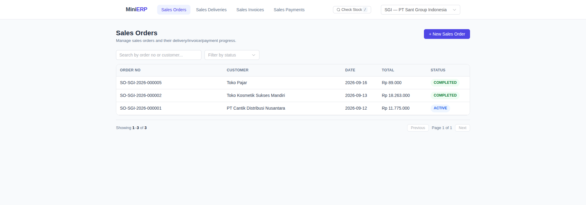
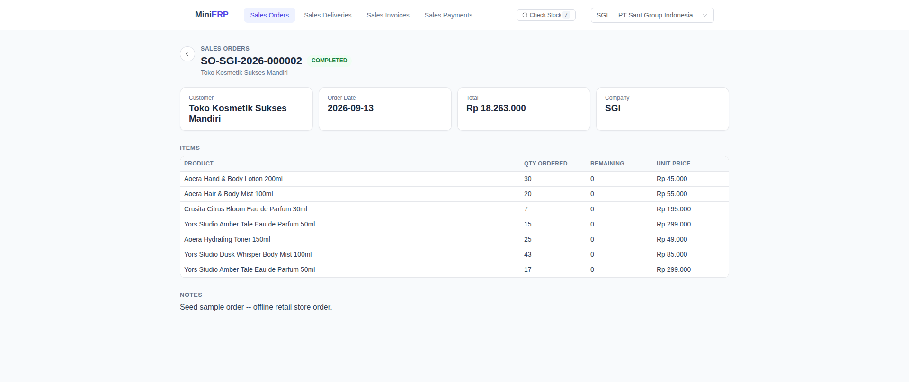
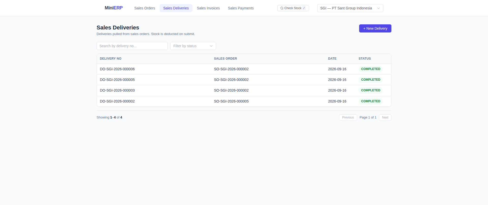
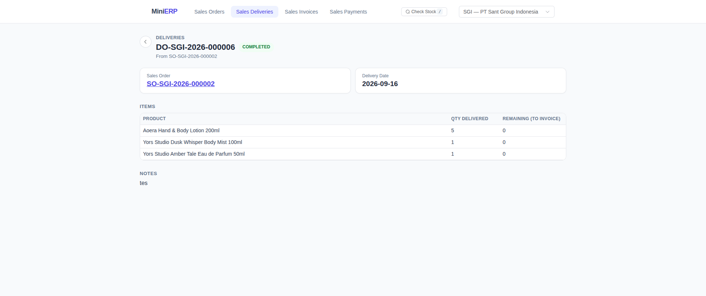
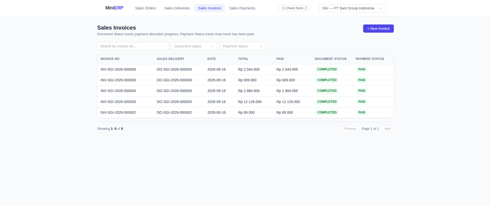
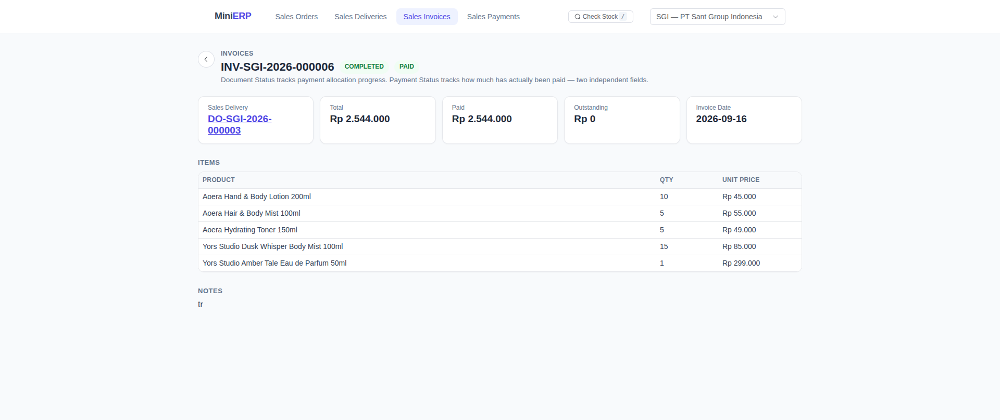
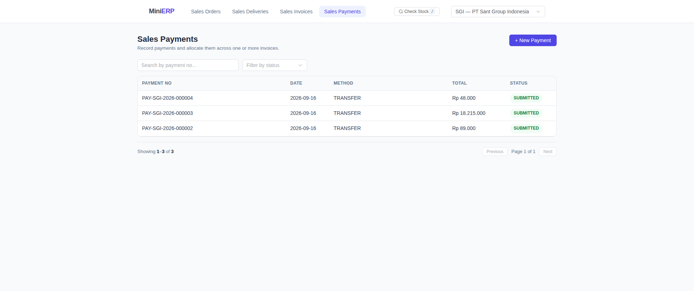
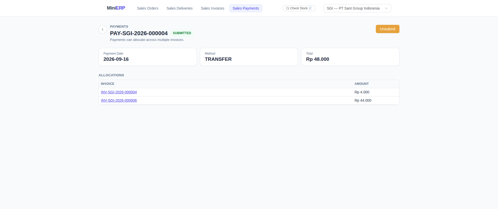
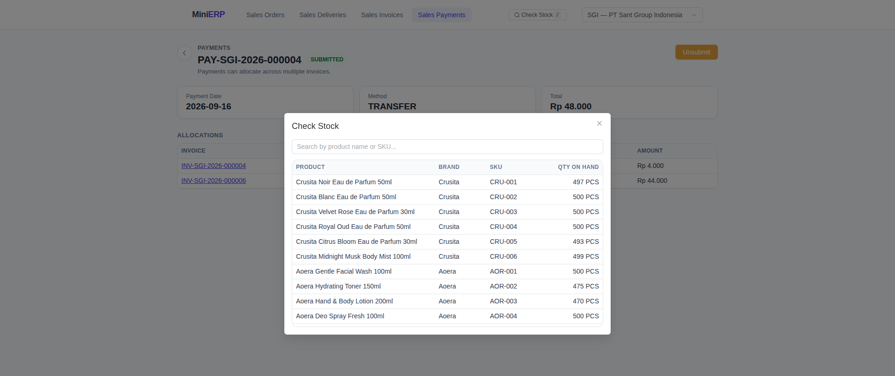
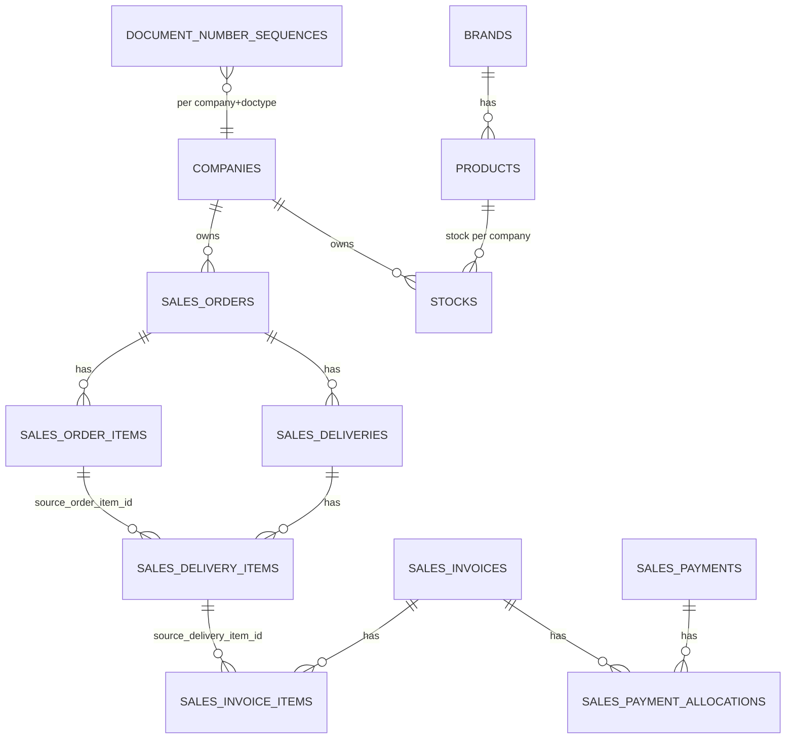

# Sant Group Mini-ERP — Sales Order Module

A Sales Order → Sales Delivery → Sales Invoice → Sales Payment module built as a technical assessment for PT Sant Group Indonesia. Backend in Go (Gin + GORM + PostgreSQL), frontend in Vue 3 (TypeScript + Pinia + Element Plus).

## Screenshots

| | |
|---|---|
| **Sales Orders — list** | **Sales Order — detail** |
|  |  |
| **Sales Deliveries — list** | **Sales Delivery — detail** |
|  |  |
| **Sales Invoices — list** | **Sales Invoice — detail** |
|  |  |
| **Sales Payments — list** | **Sales Payment — detail (multi-invoice allocation)** |
|  |  |
| **Check Stock modal** | |
|  | |

## 1. Project Overview

Implements the full document chain for a sales flow:

```
Sales Order → Sales Delivery → Sales Invoice → Sales Payment
```

Each document can be **partially pulled** into the next (partial delivery, partial invoice, partial/multi-invoice payment). Stock only moves on Delivery submit. Every transactional table is scoped to a **company**, and two companies are seeded to prove isolation. All business rules — remaining-quantity checks, stock sufficiency, overpayment rejection, submit/unsubmit cascades, delete guards — are enforced in the Go service layer inside database transactions, not in the frontend.

## 2. Tech Stack

- **Backend**: Go 1.25, Gin, GORM, PostgreSQL 16, `golang-migrate`, `shopspring/decimal` for money/qty precision, `go test` (no mocking framework — business-rule tests run against a real Postgres).
- **Frontend**: Vue 3 + TypeScript, Vite, Pinia, Vue Router, Axios, Element Plus.
- **Infra**: Docker + Docker Compose, Makefile for local (non-Docker) dev.

## 3. Running the Application

### 3a. Docker (recommended — one command)

```bash
docker compose up --build
```

This starts Postgres, then the backend (waits for the DB, runs migrations, seeds idempotent sample data, starts serving), then the frontend (nginx serving the built SPA).

- Backend: http://localhost:8080
- Frontend: http://localhost:5173
- Postgres: localhost:5544 (host-mapped, for inspecting with `psql`)

### 3b. Local (no Docker)

Requires Go 1.25+, Node 20+, and a local Postgres reachable at `localhost:5544` (a quick way to get one: `docker run -d -p 5544:5432 -e POSTGRES_DB=mini_erp -e POSTGRES_USER=erp -e POSTGRES_PASSWORD=erp postgres:16-alpine` — or just `docker compose up -d postgres` from this repo, which publishes the same port).

Copy `backend/.env.example` to `backend/.env` and adjust `DB_DSN`/`PORT` if needed — `config.Load()` reads it automatically via `godotenv` when running `go run` directly (Docker never sees this file; it injects the same variables straight from `docker-compose.yml`).

```bash
cp backend/.env.example backend/.env

make migrate-up      # apply schema migrations
make seed            # idempotent seed data
make backend-run     # go run ./cmd/server (also auto-migrates; or just `cd backend && go run ./cmd/server` once .env is set)

# in a second terminal
cd frontend && npm install && npm run dev
```

### 3c. Tests

```bash
make test
# or: cd backend && TEST_DB_DSN="host=localhost user=erp password=erp dbname=mini_erp_test port=5544 sslmode=disable" go test ./...
```

Tests run against a real Postgres (a separate `mini_erp_test` database — create it once with `createdb mini_erp_test` or `docker exec <pg-container> psql -U erp -d postgres -c "CREATE DATABASE mini_erp_test"`). The concurrency tests spin up real goroutines against real row locks, so a mocked DB would not exercise what they're testing. `-race` requires `CGO_ENABLED=1` and a C compiler; omit it if one isn't available in your environment.

## 4. Docker Setup

`docker-compose.yml` defines three services:

- `postgres` — health-checked, data persisted in a named volume.
- `backend` — multi-stage build (Go binary only in the final Alpine image, non-root user); `entrypoint.sh` waits for Postgres, runs `./migrate` (a small one-shot binary, `cmd/migrate`) to completion, optionally runs `./seed`, then execs `./server`. Migration is a separate step from the long-running server specifically so migration/seeding can never race against the server accepting traffic.
- `frontend` — multi-stage build; Vite build baked with `VITE_API_BASE_URL`, served by nginx with an SPA fallback (`try_files ... /index.html`) since Vue Router uses history mode.

## 5. Database Migrations

Plain numbered SQL files under `backend/migrations/`, applied with [`golang-migrate`](https://github.com/golang-migrate/migrate). Chosen over GORM's `AutoMigrate` because this schema needs `CHECK` constraints, composite unique indexes, and real down-migrations — things `AutoMigrate` can't express reliably.

```bash
make migrate-up
make migrate-down   # -N to step back N, or edit the Makefile target
```

## 6. Seed Data

`backend/seed/data.go`, run via `make seed` or automatically in Docker (`AUTO_SEED=true`). Idempotent — safe to re-run.

- 2 companies (`COMP1` PT Sant Retail Nusantara, `COMP2` PT Sant Manufaktur Indonesia)
- 2 brands, 10 products (5 per brand)
- 100 units of stock per product, **per company** (so company isolation is visible immediately)
- 1 sample Sales Order (`COMP1-SO-SEED-000001`, submitted/ACTIVE, 2 lines) ready to be partially delivered, invoiced, and paid by a reviewer without first building data by hand.

## 7. ERD



Full column-level DDL (PK/FK/unique/check constraints, indexes) is in `backend/migrations/`. Key design choice: **traceability lives on line items, not headers**. `sales_delivery_items.source_order_item_id` and `sales_invoice_items.source_delivery_item_id` point at the specific parent line, not just the parent document. This makes "remaining quantity" a plain aggregate:

```sql
qty_ordered - COALESCE((
  SELECT SUM(sdi.qty) FROM sales_delivery_items sdi
  JOIN sales_deliveries sd ON sd.id = sdi.sales_delivery_id
  WHERE sdi.source_order_item_id = order_item.id
    AND sd.document_status != 'DRAFT' AND sd.deleted_at IS NULL
), 0)
```

and it's what lets one Invoice pull lines from *multiple* Deliveries (each invoice line points at its own source delivery item) — see `TestSalesInvoiceService_MultiDeliveryPull_AggregatesAcrossDeliveries`. Payment → Invoice, by contrast, is header-to-header via `sales_payment_allocations` (a payment isn't product-line-based, it's a pure amount split).

Stock is keyed `(company_id, product_id)` — brand is just a product attribute, not a stock dimension. Products/brands are shared catalog data; only stock quantity and every transactional table are company-scoped.

## 8. Business Flow

```
Sales Order (DRAFT → submit → ACTIVE)
   │  create + submit Delivery, pulling qty from order lines
   ▼
Sales Delivery (DRAFT → submit → ACTIVE; stock deducted on submit)
   │  create + submit Invoice, pulling qty from delivery lines
   ▼
Sales Invoice (DRAFT → submit → ACTIVE; document_status + payment_status both start here)
   │  create + submit Payment, allocating amount to one or more invoices
   ▼
Sales Payment (DRAFT → submit → SUBMITTED; no downstream)
```

Every `submit` and `unsubmit` on Delivery/Invoice/Payment that changes stock or financial allocation runs inside **one database transaction** and recomputes the parent's status before committing (see §11 and §18.1).

## 9. Document Status Lifecycle

One field, `document_status`, on every document — **no separate `processing_status`**. It is derived, not manually set (except the explicit `submit`/`unsubmit` transitions), from how much of the document has been pulled by its own submitted children, using one shared rule (`internal/service/statusengine`):

| Pulled vs total | Tier | Order / Delivery / Invoice `document_status` |
|---|---|---|
| nothing pulled | ZERO | `ACTIVE` |
| 0 < pulled < total | PARTIAL | `PROCESSED` |
| pulled ≥ total | FULL | `COMPLETED` |

`DRAFT` is never produced by this engine — only the explicit `Submit`/`Unsubmit` handlers set it. Sales Payment only has `DRAFT`/`SUBMITTED` (no downstream, so no PROCESSED/COMPLETED distinction applies to it). There is no `CANCELLED` status — see §14 for why.

Example (matches `TestSalesDeliveryService_ParentStatus_ProcessedToActive_WhenAllDeliveriesUnsubmitted`):

```
SO qty 10, Delivery A = 3 (submitted) → SO = PROCESSED
SO qty 10, Delivery B = 7 (submitted) → SO = COMPLETED
Unsubmit Delivery B                   → SO = PROCESSED
Unsubmit Delivery A                   → SO = ACTIVE
```

## 10. Payment Status Lifecycle (Sales Invoice only)

**`payment_status` is a second, independent field that only Sales Invoice has.** It is *not* the same thing as `document_status`, even though both are derived from the same `(total_amount, paid_amount)` pair on an invoice:

- `document_status` answers: *has this invoice, as a document, been fully pulled into submitted payments?* → `ACTIVE` / `PROCESSED` / `COMPLETED`
- `payment_status` answers: *how much has actually been paid?* → `UNPAID` / `PARTIALLY_PAID` / `PAID`

They move together for this task's scope (no partial write-offs, no early/advance payment concept), but they are computed independently in code (`SalesInvoiceService.ApplyPaymentDelta`) and stored as two separate columns, precisely because a real ERP eventually needs to answer these two questions differently (e.g. a credit-memo that closes an invoice's document lifecycle without it being "paid"). Keeping them as two fields from day one avoids a schema migration later; this is the one place in the schema where we spent a column on a distinction the current business rules don't yet require, on purpose.

```
Invoice total 10,000,000; Payment 4,000,000 submitted
→ document_status = PROCESSED, payment_status = PARTIALLY_PAID

+ second Payment 6,000,000 submitted
→ document_status = COMPLETED, payment_status = PAID

Unsubmit the second payment
→ document_status = PROCESSED, payment_status = PARTIALLY_PAID
```

`paid_amount`/`outstanding_amount` are maintained transactionally on submit/unsubmit (never recomputed by summing on every read), with `CHECK (paid_amount <= total_amount)` as a DB-level backstop.

## 11. Partial Delivery / Partial Invoice / Partial Payment

All three follow the identical pattern, enforced in the service layer *inside the submit transaction* (not just at draft-creation time, since a draft can sit around while siblings consume the same remaining quantity):

1. Lock the document being submitted (`SELECT ... FOR UPDATE`).
2. Re-read the parent's remaining quantity/amount fresh, under lock.
3. Reject if the requested pull exceeds what's remaining (`ErrOverDelivery` / `ErrOverInvoice` / `ErrOverpayment`).
4. Apply the effect (deduct stock / nothing extra for invoice / apply payment delta).
5. Recompute the parent's status.
6. Commit — all or nothing.

## 12. Payment Allocation

One payment can be split across multiple invoices (`sales_payment_allocations`, one row per `(payment, invoice)` pair); one invoice can receive allocations from multiple payments over time. Overpayment is **rejected**, not allowed — see §18.3 for why.

## 13. Unsubmit Rules

| Document | Can unsubmit when... | Rationale |
|---|---|---|
| Sales Order | status is `ACTIVE` and no non-draft Delivery references it | A delivery that already moved stock against this order can't be left pointing at an order that claims to have never been confirmed. |
| Sales Delivery | status is `ACTIVE` and no non-draft Invoice references it | An invoice already claims that quantity as billed; un-shipping underneath it would orphan the invoice's basis. |
| Sales Invoice | status is `ACTIVE` and no `SUBMITTED` Payment allocates against it | A payment already reduced this invoice's outstanding balance; un-confirming the invoice underneath it would leave the payment pointing at a bill that officially never existed. |
| Sales Payment | always, while `SUBMITTED` | No downstream document references a payment, so there's nothing to protect. |

Every unsubmit restores the effect it caused (stock for Delivery, `paid_amount`/status for Invoice via Payment) and recomputes the parent's status — all inside one transaction (see `SalesDeliveryService.Unsubmit`, `SalesInvoiceService.Unsubmit`, `SalesPaymentService.Unsubmit`).

## 14. Delete Rules (and Cancellation)

**Delete is only allowed for `DRAFT` documents.** A document that has been submitted — even if nothing downstream has happened yet — must go through `Unsubmit` first (Order/Delivery/Invoice), never silently deleted, because a submitted document already claims a document number and (for Order) a confirmed customer commitment; deleting it would break the numbering/audit trail even before any stock or money moved.

This directly implements the spec's core delete rule: **a Sales Order that has already been partially or fully delivered can never be deleted.** By the time it has a submitted Delivery against it, its own status is `PROCESSED`/`COMPLETED`, never `DRAFT`, so the DRAFT-only delete guard rejects it automatically. Unsubmit adds the second half of the guard: an order can only unsubmit (back to DRAFT) while it has **zero** submitted deliveries, so a partially-delivered order can never reach DRAFT-and-therefore-deletable either.

**Cancellation is intentionally *not* a separate status or action.** An earlier version of this design added a dedicated `CANCELLED` status and `Cancel` endpoint for a submitted-but-undelivered order. It was removed once it became clear it added a fourth document-status value and a fifth endpoint to explain, for zero behavior the existing two actions didn't already cover: an `ACTIVE` order with no deliveries can always be `Unsubmit`ted back to `DRAFT`, and a `DRAFT` order can always be `Delete`d. **Unsubmit + Delete together already are the cancellation flow** — running them in sequence produces exactly the outcome a dedicated Cancel would have (the order gone, its document number's fate explicit), without inventing a state that only ever appears at the very end of an order's life and interacts with nothing else in the system. This is the trade-off actually being made for "Pembatalan" in this design: cancellation is not a new primitive, it is the composition of two primitives that already have to exist and be correct for other reasons. Soft delete (`deleted_at`) is used everywhere a delete is allowed, so even a deleted draft's document number is never silently reused.

## 15. Stock Concurrency Handling

See §18.1 for the full answer. Summary: `SELECT ... FOR UPDATE` on the `stocks` rows (sorted by `product_id`), inside the same transaction as the remaining-quantity check, the deduction, and the parent-status recompute. `TestSalesDeliveryService_ConcurrentSubmit_StockRaceRejectsOversell` fires two real goroutines at 70+50 units of delivery against 100 units of stock and asserts exactly one succeeds and stock never goes negative — it has been run 8x back to back with zero flakiness during development.

## 16. Multi-Company Isolation

Every transactional table carries `company_id`. Enforcement is two-layered:

- **Query scoping**: every list/read filters by `company_id` (via `X-Company-ID` header/query param — see §21 on the auth stand-in).
- **Cross-reference guard**: `service.AssertSameCompany` rejects creating a Delivery/Invoice/Payment-allocation against a parent (Order/Delivery/Invoice) that belongs to a different company, even if the caller's own `company_id` is otherwise valid. See `TestMultiCompanyIsolation_CannotDeliverAgainstOtherCompanyOrder`.
- **Stock isolation**: `stocks` is unique on `(company_id, product_id)`; a delivery only ever locks/deducts its own company's row. See `TestMultiCompanyIsolation_StockNotSharedAcrossCompanies`.
- **Numbering isolation**: document numbers embed the company code (`SO-COMP1-2026-000001` vs `SO-COMP2-2026-000001`) and are assigned from a per-`(company_id, doc_type)` sequence row, so two companies' first order both being `...-000001` is expected, not a collision. See `TestMultiCompanyIsolation_DocumentNumberingIsPerCompany`.

## 17. Automated Tests

30 tests total (`cd backend && go test ./...`): 3 unit tests for the shared status-derivation engine (`internal/service/statusengine`) and 27 integration tests (`tests/integration/`) that run every business rule against a real Postgres — nothing about locking, transactions, or aggregate queries is meaningful against a mock, so none of these mock the database. Highlights:

- Partial/full delivery, over-delivery rejection, stock deduction + restore on unsubmit
- **Concurrent delivery submit against limited stock** (`concurrency_test.go`) — the required race-safety test
- Partial/full invoice, over-invoice rejection, multi-delivery-sourced invoice
- Partial/multiple/multi-invoice payment, overpayment rejection (both at draft-time and the authoritative submit-time race case), unsubmit reverting `PAID → PARTIALLY_PAID → UNPAID`
- Parent status cascades in both directions (`COMPLETED → PROCESSED → ACTIVE` as children are unsubmitted)
- Multi-company isolation (cross-company reference rejection, stock non-sharing, independent numbering)
- Concurrent document-number generation producing no duplicates

## 18. Technical Task Questions

### 18.1 How does the system prevent two concurrent delivery requests from driving stock negative?

Every delivery submit runs inside one database transaction that, in order: (1) locks the delivery row itself (`SELECT ... FOR UPDATE`), (2) locks the affected `stocks` rows — always sorted ascending by `product_id` — with `SELECT ... FOR UPDATE`, (3) re-validates both remaining order quantity and stock sufficiency using data read *under that lock*, (4) deducts stock and marks the delivery submitted, (5) locks and recomputes the parent order's status, then commits. If two deliveries race for the same product's stock, the second transaction blocks on the `FOR UPDATE` lock until the first commits (or rolls back); when it proceeds, it sees the already-decremented quantity and is correctly rejected if insufficient. The lock is always sorted by `product_id` across the whole codebase (`StockRepository.LockForUpdate`, `SalesInvoiceRepository.LockManyForUpdate`) so no two transactions can ever hold overlapping locks in reverse order — deadlock is structurally impossible, not just made unlikely. This is proven, not just asserted: `TestSalesDeliveryService_ConcurrentSubmit_StockRaceRejectsOversell` fires two real goroutines at once.

### 18.2 If Sales Order grows to 2 million rows, what slows down first, and what's the fix?

The first bottleneck is **list/detail queries doing per-row aggregate lookups** — but this design already avoids that for the common path: `document_status`/`payment_status` are stored columns, updated transactionally on submit/unsubmit, never recomputed by summing child tables on every read. The place that *would* still hurt at 2M rows is (a) the `sales_orders` list endpoint's plain `LIMIT/OFFSET` pagination, which gets linearly slower as `OFFSET` grows because Postgres still has to scan and discard every skipped row, and (b) the `GET /sales-orders/:id` remaining-quantity computation, which does one `SUM()` aggregate query per line item (fine for a handful of lines, but N+1-shaped if an order had hundreds of lines). Fixes, roughly in the order I'd apply them: **switch to keyset/cursor pagination** (`WHERE id < :last_id ORDER BY id DESC LIMIT :n`, using the existing `idx_so_company_created` index) instead of `OFFSET`; **batch the remaining-qty aggregate** into one grouped query per order-detail request instead of one query per line; ensure the connection pool (`gorm`'s underlying `sql.DB` `SetMaxOpenConns`) is sized to the deployment's concurrency rather than left at Go's default; consider **partitioning `sales_orders`/`sales_order_items` by `company_id` and year** once a single company's history dominates the table, since almost every query is already scoped by `company_id`; and add a **read-through cache for the company/brand/product catalog lookups** (rarely-changing master data hit on every request) if request volume ever makes that a measurable fraction of load — transactional writes themselves wouldn't benefit from caching and aren't the bottleneck here, since each write transaction is already narrowly scoped to a few locked rows, not a table scan.

### 18.3 What was cut for time, and what would come first with one more week?

**Cut deliberately** (see the full list in §21): no authentication (company is passed as a plain header, documented as a stand-in for a real session); no pricing/discount/tax engine (unit price is entered per line, totals are a naive sum); no customer/vendor master data (`customer_name` is free text); no audit/change-log table beyond `created_at`/`updated_at`/`submitted_at`; no multi-warehouse (stock has no location dimension); plain `LIMIT/OFFSET` pagination (see §18.2); no frontend E2E tests — test effort went entirely into the Go business-rule/concurrency suite, per the task's own stated grading priority of correctness over completeness over UI. Overpayment is rejected outright rather than allowing a credit-balance concept, which is a real simplification of ERP behavior but was the explicitly suggested default in the task brief. With one more week, in order: (1) real authentication/session handling in place of the `X-Company-ID` header stand-in, since that's the one simplification that would need to change before this could be exposed beyond a trusted internal network; (2) keyset pagination and a batched remaining-qty query, since those are the concretely identified scale bottlenecks; (3) a minimal audit log (who submitted/unsubmitted what, when) since ERPs get asked for this immediately in practice; (4) a small pricing/tax layer, since real sales documents need it; (5) frontend E2E coverage of the golden path.

## 19. Assumptions

- **Terminology**: this document and the codebase say **"Company"** everywhere the task brief says **"entitas legal"** (legal entity) — same concept, renamed once for a friendlier user-facing term (this is also the convention most real ERPs use: SAP, Odoo, Xero, and QuickBooks all call it "Company" in the UI, reserving "legal entity" for internal/legal documentation). It refers to a separately incorporated company (its own tax ID, its own books) — never a brand, and never an office/function. The seed data's two companies (`COMP1` PT Sant Retail Nusantara, `COMP2` PT Sant Manufaktur Indonesia) map directly to the brief's retail/manufaktur functions, each run by its own legal entity.
- No authentication exists in the source system this stands in for; a real deployment would resolve the company from an authenticated session instead of a client-supplied header.
- `customer_name` is free text — no customer master data module was in scope.
- One order line = one product; no BOM/kit/bundle concept.
- Document numbers are assigned at **draft creation**, not at submit — chosen for simplicity and because list views read more naturally with a number already present. The accepted cost: a deleted/abandoned draft leaves a gap in the sequence. This was an explicit, deliberate trade-off, not an oversight.
- "Available stock" has no reservation concept — stock is only checked/deducted at delivery submit, exactly as the spec requires (not reserved at order time), so two orders can both show the same nominal stock as available until one of them actually delivers.

## 20. Technical Decisions

- **One reusable status-derivation algorithm** (`internal/service/statusengine`) instead of bespoke per-document status logic, so Order/Delivery/Invoice status all provably follow the same rule (see §9) — this was the single highest-value abstraction for correctness, since the spec's trickiest requirement is that this rule behaves identically and cascades correctly in both directions at every level.
- **Traceability on line items, not headers** (§7) — the design choice that makes "remaining quantity" a simple query instead of a stateful running total that could drift.
- **A fixed, app-wide lock-ordering invariant** (document row → sorted peer rows → parent row, always in that order) rather than per-feature ad hoc locking, so deadlock-freedom is a structural property of the codebase, not something verified case by case.
- **`shopspring/decimal` everywhere money/qty is touched** — floating point has no place in a ledger; every arithmetic operation in the service layer uses exact decimal math matching Postgres `NUMERIC`.
- **Soft delete + delete only for DRAFT** (§14) rather than a separate "cancelled but still queryable" vs "gone" distinction — kept the state space small while still preserving history for anything that was ever submitted.

## 21. Trade-offs / Out of Scope

- No authentication/authorization/session model — `X-Company-ID` header stands in for it (§18.3 explains why this would be the first thing to replace).
- No pricing/discount/tax engine.
- No customer/vendor master data, no multi-warehouse, no file attachments/PDF/email.
- No field-level audit/change-log table.
- Plain `LIMIT/OFFSET` pagination, not keyset (§18.2).
- No frontend E2E tests (Cypress/Playwright); test investment went into the Go business-rule/concurrency suite per the stated grading weights.
- No CRUD UI for companies/brands/products (seed-only) — only the four required documents get full list/detail/create/submit/unsubmit UI.
- Desktop-oriented Element Plus layout; no dedicated mobile responsiveness pass.

## 22. AI Tool Usage Disclosure

This implementation was built with Claude Code (Anthropic), used for scaffolding the Go/Vue project structure, writing the migrations/service/handler/test code from the design captured in this README, and iteratively running the real test suite and a live Postgres/Docker stack to verify behavior (all `go test` output, the concurrency-test results, and the curl-driven end-to-end walkthrough referenced in this README were executed against real infrastructure during development, not hand-waved). Every design decision, business rule, and trade-off above reflects an explicit choice made and is one I can walk through and defend line by line in the technical Q&A session, per the task's requirement.

## 23. Known Limitations (explicitly open)

- The `X-Company-ID` header has no cryptographic binding to anything — any caller can claim any company. This is acceptable only because there is no auth in scope at all; it is not a partial security feature.
- `GET /sales-orders/:id` and `GET /sales-deliveries/:id` each run one aggregate query per line item to compute `remaining_qty`; fine at assessment scale, called out in §18.2 as the first thing to batch at scale.
- The frontend was verified end-to-end via the real backend API (curl-driven walkthrough of the full Order→Delivery→Invoice→Payment flow, plus a Docker Compose smoke test with actual cross-origin requests) and passed a full TypeScript build (`vue-tsc -b && vite build`) with no errors, but was **not** visually clicked through in a real browser during this session (no browser-automation tool was available in this environment) — the operator should do a manual click-through of the golden path before the walkthrough.
